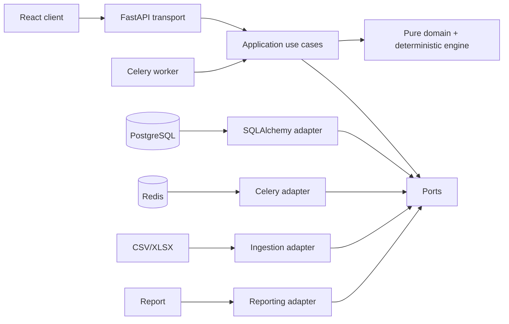

# Architecture

ReconcileFlow is a modular monolith with independently replaceable transport and infrastructure adapters. The first deployment runs an API, a Celery worker, PostgreSQL, Redis, and a static React client.

Dependency arrows in code point inward: adapters and API import application/domain; application imports domain; domain imports only the standard library. `scripts/check_architecture.py` enforces the critical boundary.

The reconciliation engine receives canonical transactions and an explicitly versioned rule-set snapshot. It builds candidates without mutating inputs, resolves unique candidates, emits ambiguity for ties, and tracks consumed participant IDs. Completed result records are immutable snapshots.

See `docs/adr/` for decisions and `docs/DOMAIN.md` for invariants.
