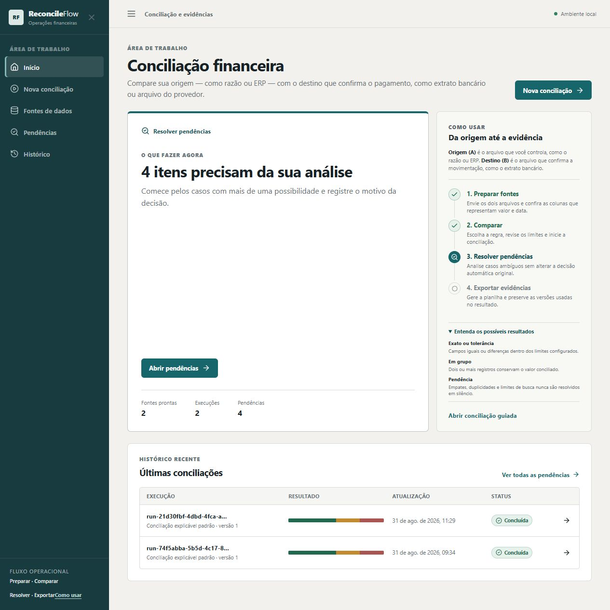
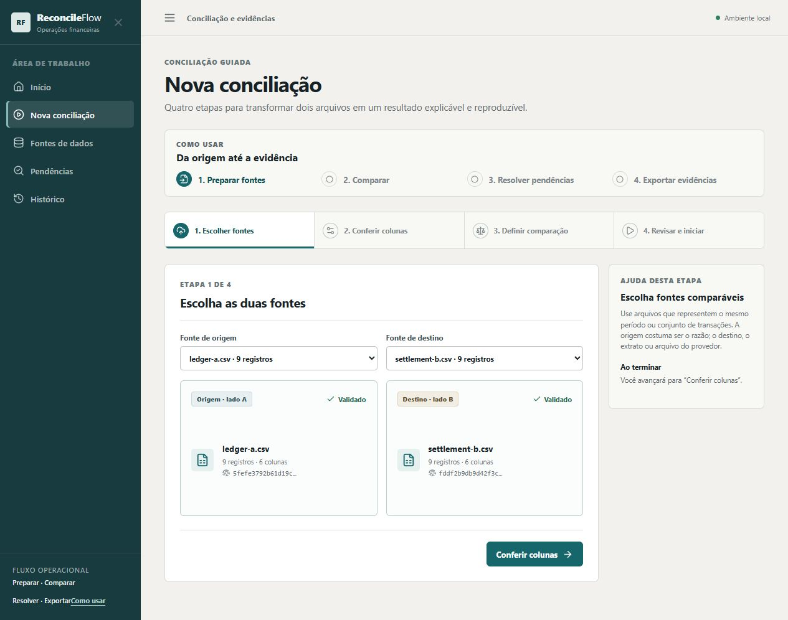
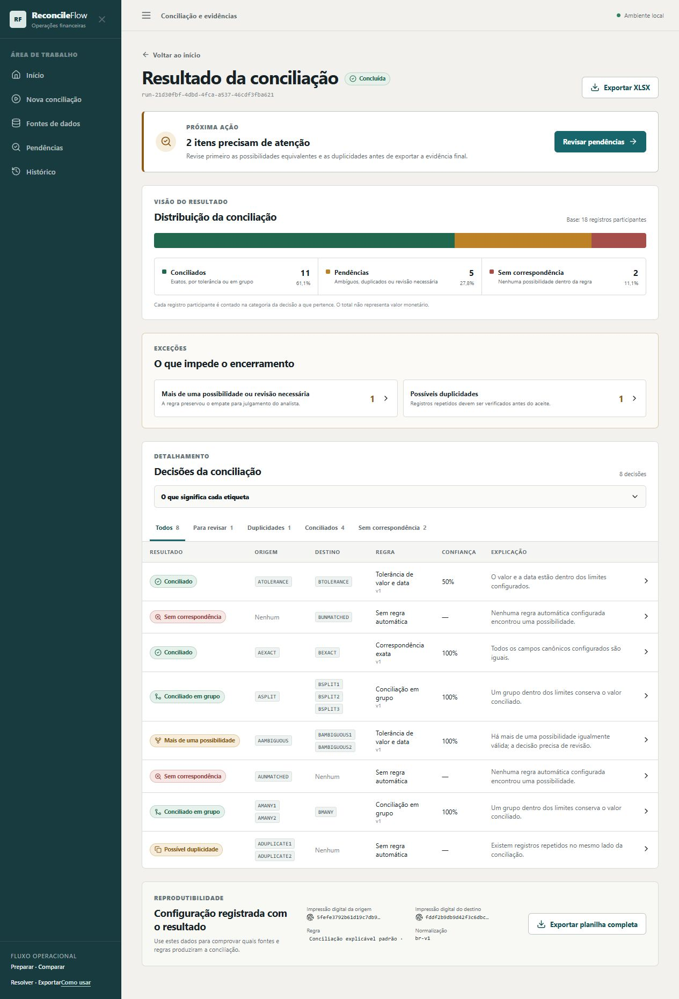
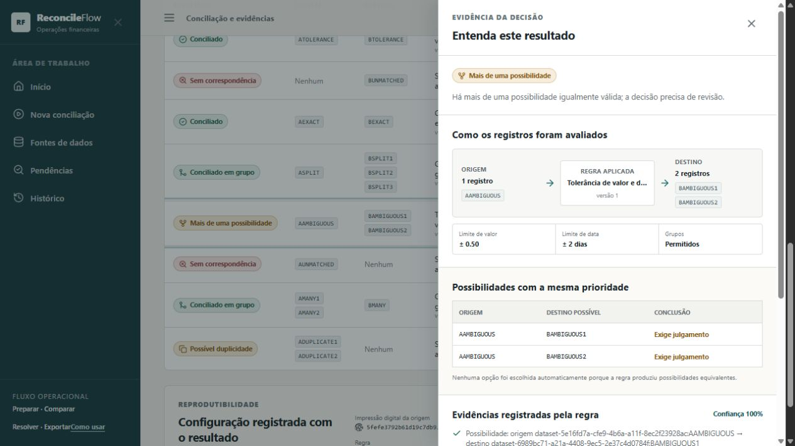
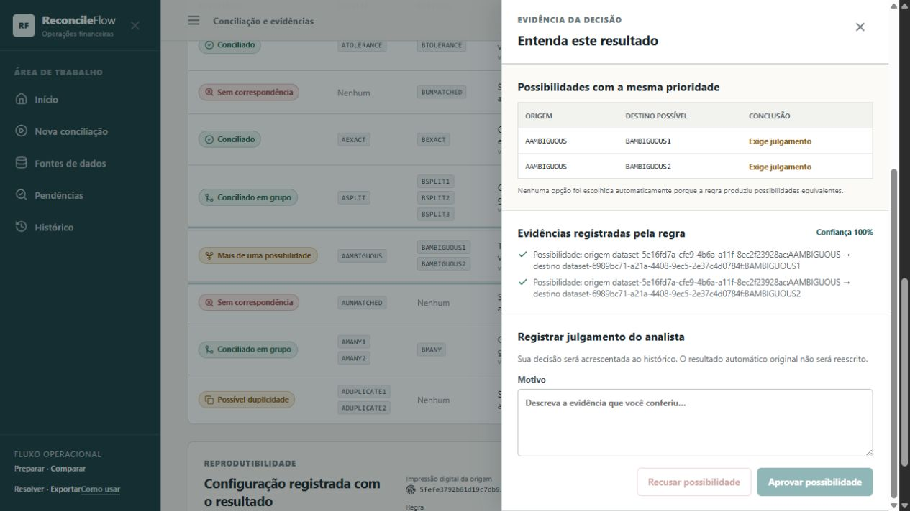

<h1 align="center">ReconcileFlow</h1>

  <strong>Reconciliação de dados determinística, explicável e pronta para auditoria.</strong>

  
  
  
  
  
  

ReconcileFlow transforma duas fontes financeiras em decisões de conciliação reproduzíveis. Cada resultado informa o que foi comparado, qual regra versionada foi aplicada, por que a decisão foi tomada e quais evidências sustentam o resultado.

O projeto vai além de um CRUD: ele inclui ingestão delimitada de CSV e XLSX, normalização explícita, regras determinísticas, correspondências compostas, revisão humana, trilha de auditoria, exportação e um harness de engenharia que mantém código, especificações, fixtures e avaliações alinhados.

## O problema

Conciliações reais raramente se resumem a comparar duas colunas. Valores podem chegar em formatos diferentes, datas podem variar, uma transação pode ser dividida em várias linhas e múltiplas combinações podem parecer válidas. Sem regras explícitas, o resultado se torna difícil de reproduzir e quase impossível de auditar.

O ReconcileFlow trata cada etapa como parte do produto:

~~~mermaid
flowchart LR
    A[Fontes CSV ou XLSX] --> B[Normalização br-v1]
    B --> C[Regras versionadas]
    C --> D{Decisão}
    D --> E[Reconciliado]
    D --> F[Divisão reconciliada]
    D --> G[Ambíguo]
    D --> H[Duplicado]
    D --> I[Não reconciliado]
    E --> J[Evidências e auditoria]
    F --> J
    G --> K[Revisão manual]
    H --> K
    I --> K
    K --> J
    J --> L[Exportação XLSX]
~~~

## Como as correspondências funcionam

As regras são aplicadas em ordem previsível e registram sua versão em cada decisão.

| Regra | Exemplo | Resultado |
| --- | --- | --- |
| Exata composta | R$ 1.234,56 e 1234.56, com mesma data e identificadores | Correspondência exata após normalização |
| Tolerância de valor e data | 750,10 e 750,35 com um dia de diferença | Correspondência quando estiver dentro dos limites configurados |
| Divisão limitada | 1.000,00 de um lado e 500,00 + 300,00 + 200,00 do outro | Correspondência composta com conservação do valor |

O perfil padrão standard@1 usa tolerância de R$ 0,50, tolerância de dois dias e busca de divisão limitada a grupos de quatro itens, vinte candidatos e cinco mil combinações. Esses limites são parte da configuração versionada, evitando buscas combinatórias sem controle.

### Explicabilidade por decisão

Uma resposta da API contém os identificadores envolvidos, o estado, a regra e sua versão, a confiança, a explicação e as evidências utilizadas:

~~~json
{
  "decision_id": "dec-...",
  "status": "SPLIT_MATCHED",
  "source_ids": ["src-001"],
  "target_ids": ["tgt-001", "tgt-002", "tgt-003"],
  "rule_id": "bounded_split",
  "rule_version": "1",
  "confidence": "1.000000",
  "explanation": "A bounded group conserves the reconciled amount.",
  "evidence": [
    "amount delta 0.00 <= 0.50",
    "currency: equal",
    "date span 0d <= 2d",
    "group size 3 <= 4"
  ]
}
~~~

## Tour do produto

### 1. Crie uma conciliação guiada

A interface orienta o envio das fontes, o mapeamento das colunas, a escolha do perfil e a execução.

### 2. Leia a distribuição dos resultados

O resumo mostra quantos registros foram reconciliados, divididos, ficaram ambíguos, duplicados ou não conciliados.

### 3. Inspecione a explicação

Cada linha abre uma visão detalhada com regra, confiança, valores comparados e evidências.

### 4. Registre a revisão humana

Casos ambíguos podem ser revisados sem apagar o resultado original. A decisão humana é acrescentada à trilha de auditoria.

## Garantias de engenharia

| Garantia | Como é aplicada |
| --- | --- |
| Determinismo | Ordenação estável, aritmética decimal e regras sem dependência da ordem de entrada |
| Reprodutibilidade | Perfil, regra, versão e normalizador são persistidos com a execução |
| Explicabilidade | Toda decisão retorna explicação estruturada e evidências |
| Auditabilidade | Revisões, decisões e exportações são append-only após a conclusão |
| Segurança de ingestão | Tipos e formatos explícitos, limites de arquivo e rejeição de valores inválidos |
| Evolução segura | Migrações Alembic, contratos testados e gate único de verificação |
| Busca controlada | Limites explícitos para candidatos, grupos e combinações de divisão |

## Arquitetura

~~~mermaid
flowchart TB
    UI[React 19 + TypeScript] --> API[FastAPI]
    API --> APP[Casos de uso]
    APP --> DOMAIN[Domínio determinístico]
    APP --> PORTS[Portas]
    PORTS --> PG[(PostgreSQL 17)]
    PORTS --> FILES[CSV e XLSX]
    PORTS --> QUEUE[Redis + Celery]
    WORKER[Worker] --> APP
    API --> AUDIT[Auditoria append-only]
    WORKER --> AUDIT
~~~

- O domínio concentra normalização, regras de correspondência, estados e explicações.
- A camada de aplicação coordena ingestão, execução, revisão e exportação.
- Adaptadores implementam persistência, fila e formatos de arquivo.
- A API e a interface expõem o fluxo sem duplicar regras de negócio.
- PostgreSQL reforça a imutabilidade de execuções concluídas e decisões por meio de triggers.

### Pipeline de correspondência

~~~mermaid
sequenceDiagram
    participant I as Ingestão
    participant N as Normalização
    participant E as Regra exata
    participant T as Tolerância
    participant S as Divisão limitada
    participant A as Auditoria
    I->>N: linhas das fontes
    N->>E: registros canônicos
    E->>T: itens ainda disponíveis
    T->>S: itens ainda disponíveis
    S->>A: decisões e evidências
    E->>A: decisões e evidências
    T->>A: decisões e evidências
~~~

## Harness Engineering e desenvolvimento com agentes

O repositório foi organizado para que humanos e agentes de código consigam entender o sistema, alterar uma regra e provar o comportamento sem depender de contexto implícito.

~~~mermaid
flowchart TD
    G[AGENTS.md] --> W[Forma de trabalhar]
    AR[ARCHITECTURE.md] --> C[Limites e dependências]
    S[specs] --> B[Comportamento esperado]
    F[fixtures] --> B
    E[evals] --> Q[Critérios de qualidade]
    T[tests] --> Q
    P[docs e planos] --> R[Decisões e evolução]
    W --> V[make verify]
    C --> V
    B --> V
    Q --> V
    R --> V
~~~

| Superfície do harness | Responsabilidade |
| --- | --- |
| AGENTS.md | Regras operacionais para contribuições assistidas |
| ARCHITECTURE.md | Fronteiras entre domínio, aplicação, portas e adaptadores |
| docs e ADRs | Decisões de produto, segurança, confiabilidade e arquitetura |
| specs | Requisitos verificáveis por capacidade |
| fixtures | Casos sintéticos golden e adversariais |
| evals | Critérios executáveis de qualidade e explicabilidade |
| scripts e tools | Automação repetível para verificação e demonstração |
| make verify | Gate local equivalente ao núcleo do CI |

### Ciclo de regressão

Um defeito relevante deve virar um exemplo reproduzível antes de ser considerado encerrado.

~~~mermaid
flowchart LR
    A[Defeito observado] --> B[Fixture mínima]
    B --> C[Teste ou avaliação]
    C --> D[Correção]
    D --> E[make verify]
    E --> F[Proteção permanente]
~~~

As propriedades geradas com Hypothesis verificam, entre outros pontos:

- ida e volta da normalização monetária;
- independência da ordem de entrada na regra exata;
- conservação de valores na divisão;
- estabilidade do pipeline após embaralhamentos.

## Qualidade atual

O gate completo executa:

- 84 testes de backend com cobertura de 86,42% e mínimo obrigatório de 85%;
- 10 testes unitários e de componentes no frontend;
- 2 cenários de navegador com Playwright;
- validação de que o banco chega à migração 0001;
- análise estática com Ruff, Mypy, ESLint, TypeScript e Bandit;
- auditorias de dependências Python e npm;
- varredura de padrões de credenciais;
- validações dos artefatos de entrega e da documentação.

Execute tudo localmente com:

~~~bash
make verify
~~~

## Tecnologias

| Área | Stack |
| --- | --- |
| Backend | Python 3.12, FastAPI, Pydantic, SQLAlchemy, Alembic |
| Motor de regras | Decimal, regras versionadas e Hypothesis |
| Banco | PostgreSQL 17 |
| Processamento assíncrono | Redis 8 e Celery |
| Frontend | React 19, TypeScript, Vite e TanStack Query |
| Arquivos | CSV e XLSX com openpyxl |
| Entrega | Docker Compose, Nginx e GitHub Actions |
| Qualidade | Pytest, Vitest, Playwright, Ruff, Mypy, ESLint e Bandit |

## Execução rápida com Docker

Pré-requisitos: Docker Engine com o plugin Docker Compose e Make.

~~~bash
git clone https://github.com/bregaldahq/reconcileflow.git
cd reconcileflow
make bootstrap
docker compose up --build
~~~

Depois, abra http://localhost:8080. A API fica disponível em http://localhost:8000/docs.

Para carregar o conjunto sintético de demonstração:

~~~bash
make demo
~~~

Para encerrar os serviços:

~~~bash
docker compose down
~~~

Nenhum dado bancário real é incluído. Os exemplos e as screenshots usam somente fixtures sintéticas.

## Desenvolvimento local

~~~bash
make bootstrap
make up
make migrate
make test
make lint
make verify
~~~

Comandos adicionais e detalhes operacionais estão em [docs/DEVELOPMENT.md](docs/DEVELOPMENT.md) e [docs/DEPLOYMENT.md](docs/DEPLOYMENT.md).

## Estrutura do repositório

~~~text
backend/          API, domínio, aplicação, adaptadores, migrações e testes
frontend/         interface React e testes de navegador
config/           regras e perfis versionados
docs/             produto, arquitetura, operação, ADRs e segurança
specs/            requisitos verificáveis por capacidade
fixtures/         conjuntos sintéticos golden e adversariais
evals/            avaliações do comportamento do motor
scripts/          automações de desenvolvimento e entrega
tools/            verificadores auxiliares do harness
.github/          pipeline de CI/CD
~~~

## CI/CD

Pull requests e pushes para main executam lint, testes, cobertura, build do frontend, testes de navegador, migrações, auditorias e build das imagens. Tags no formato v* publicam imagens versionadas quando as credenciais do registry estão configuradas.

O deploy remoto é deliberadamente opt-in. Ele só é executado quando a variável de repositório DEPLOY_ENABLED está definida como true e os ambientes e segredos descritos em [docs/DEPLOYMENT.md](docs/DEPLOYMENT.md) foram configurados.

## Limitações e próximos passos

Esta primeira versão pública prioriza um fluxo local e demonstrável. O modo de demonstração usa o cabeçalho X-Actor-Id e ainda não integra um provedor de identidade nem isolamento multi-tenant. Antes de uso com dados reais, configure autenticação, autorização, gestão de segredos, backups, observabilidade e a política de retenção adequada ao ambiente.

Próximas evoluções previstas incluem:

- perfis de conciliação administráveis com versionamento explícito;
- autenticação corporativa e controle de acesso;
- observabilidade operacional e métricas de qualidade;
- novos conectores de origem e formatos de exportação;
- ampliação das fixtures adversariais e benchmarks de escala.

## Autor

Criado e mantido por [Ricardo Bregalda](https://linkedin.com/in/ricardomeneguzzibregalda/).

## Licença

Distribuído sob a licença MIT. Consulte [LICENSE](LICENSE).
